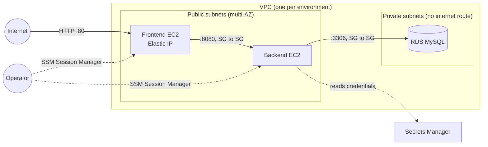

# terraform-aws


Terraform for a three-tier web app on AWS (frontend EC2, backend EC2, MySQL RDS), deployed as three isolated environments: **dev**, **staging** and **prod**.

## Architecture



- Only the frontend accepts traffic from the internet. The backend accepts traffic only from the frontend security group, and the database only from the backend security group.
- No SSH and no key pairs. Shell access goes through **SSM Session Manager**, so port 22 is closed everywhere.
- The database password is generated and stored by RDS in **Secrets Manager** (`manage_master_user_password`). It is never in a tfvars file or in Terraform state. The backend instance role can read that one secret.
- EBS and RDS storage are encrypted, and instances require IMDSv2.

## Repository layout

```
.
├── bootstrap/            # one-time: S3 bucket for remote state
├── modules/
│   ├── network/          # VPC, public/private subnets across AZs, routing
│   ├── compute/          # EC2 + security group + IAM role (reused for frontend and backend)
│   └── database/         # RDS MySQL + subnet group + security group
└── envs/
    ├── dev/              # each env: own root module, own state file, own tfvars
    ├── staging/
    └── prod/
```

Each environment is a separate root module with its own state (`<env>/terraform.tfstate` in S3, locked with S3 native locking). A `terraform apply` in dev cannot touch prod. The `.tf` files are the same in every env; **only `terraform.tfvars` differs**:

| | dev | staging | prod |
|---|---|---|---|
| VPC CIDR | 10.10.0.0/16 | 10.20.0.0/16 | 10.30.0.0/16 |
| Availability zones | 2 | 2 | 3 |
| Frontend / backend | 1 × t3.micro | 1 × t3.small | 2 × t3.medium |
| RDS class | db.t3.micro | db.t3.small | db.t3.medium |
| Multi-AZ RDS | no | no | yes |
| Backup retention | 0 days | 3 days | 14 days |
| Deletion protection | no | no | yes |
| Final snapshot | skipped | skipped | kept |

The VPC CIDRs don't overlap, so the environments can be peered later if needed.

## Usage

Requirements: Terraform >= 1.10, AWS credentials for the target account.

**1. Create the state bucket (once)**

```sh
cd bootstrap
terraform init
terraform apply -var="bucket_name=<globally-unique-bucket-name>"
```

**2. Deploy an environment**

```sh
export TF_STATE_BUCKET=<bucket-name-from-step-1>
make plan ENV=dev
make apply ENV=dev
```

Or without make:

```sh
terraform -chdir=envs/dev init -backend-config="bucket=$TF_STATE_BUCKET"
terraform -chdir=envs/dev plan -out=dev.tfplan
terraform -chdir=envs/dev apply dev.tfplan
```

**3. Connect to an instance**

```sh
aws ssm start-session --target $(terraform -chdir=envs/dev output -json backend_instance_ids | jq -r '.[0]')
```

**4. Read the database credentials**

```sh
aws secretsmanager get-secret-value \
  --secret-id $(terraform -chdir=envs/dev output -raw database_secret_arn) \
  --query SecretString --output text
```

## CI

GitHub Actions runs on every pull request:

- `terraform fmt -check`
- `terraform validate` for each environment
- `tflint` with the AWS ruleset

## Trade-offs and next steps

These were left out on purpose to keep cost low for a side project. In a real production setup I would add:

- An **Application Load Balancer** with HTTPS (ACM) in front of an Auto Scaling Group, instead of fixed instances with Elastic IPs.
- Backend instances in **private subnets** behind a NAT gateway or VPC endpoints. They are in public subnets here to avoid NAT gateway cost, but their security group only allows traffic from the frontend.
- A plan/apply pipeline using GitHub OIDC to assume an AWS role, with a manual approval step for prod.
- Separate AWS accounts per environment (AWS Organizations).

## License

MIT. See [LICENSE.txt](LICENSE.txt).
